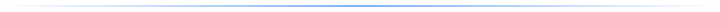
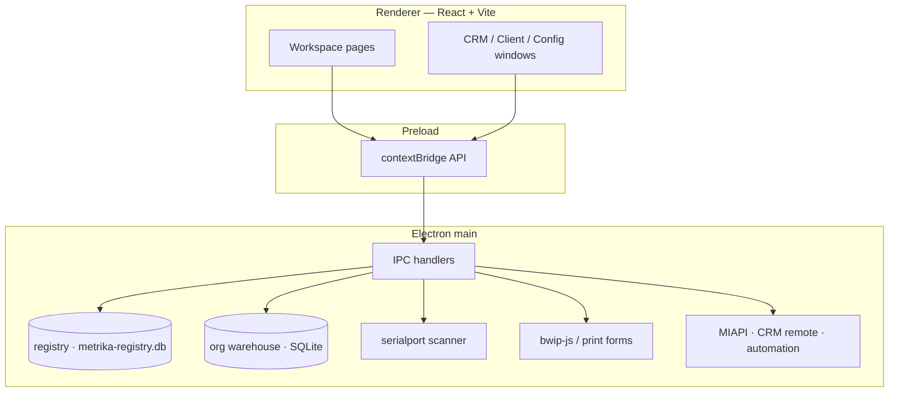
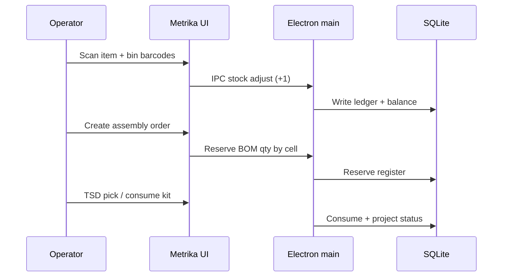

<p align="center">
  🇺🇸 English · <a href="README.ru.md">🇷🇺 Русский</a>
</p>

<p align="center">
  <picture>
    <source media="(prefers-color-scheme: dark)" srcset="docs/assets/readme/wordmark-dark.svg" />
    
  </picture>
</p>

<p align="center">
  <strong>Local warehouse inventory for Windows</strong><br />
  Catalog · barcodes · bin locations · assembly · analytics<br />
  No cloud account. Empty on first launch. Your data stays on your PC.
</p>

<p align="center">
  <a href="LICENSE"></a>
  <a href="package.json"></a>
  
  
  
  
  
  
</p>

<p align="center">
  <a href="https://krwg.github.io/metrika/demo/"><strong>▶ Play online demo</strong></a> ·
  <a href="https://github.com/krwg/metrika/releases/tag/v0.5.0"><strong>Download Windows installer</strong></a> ·
  <a href="#getting-started">Getting started</a> ·
  <a href="docs/USER_GUIDE.md">User guide</a> ·
  <a href="docs/ARCHITECTURE.md">Architecture</a>
</p>

<p align="center">
  
</p>

## Overview

**Metrika Home** is a desktop inventory system for workshops, labs, small warehouses, and home component stores. It connects catalog, barcode scanning, bin maps, stock moves, stocktakes, assembly projects, replenishment, and analytics in one **local SQLite database**.

**0.5 Home** is the local-first product line: daily work does not require a server or cloud login. An optional extended contour (organizations, documents, CRM, internal EDO) runs on the same machine — not as a hosted SaaS.

| Designed for | Not designed as |
| --- | --- |
| One PC as the source of truth | Mandatory cloud SaaS |
| Scanner-first stock placement | Replacement for certified EDO / УКЭП operators |
| Small teams and personal shops | Multi-site ERP without your own server |

### What’s new in the public Home [0.5] installer

- **Fresh install = empty launcher** — no demo org, no seeded users, no default password  
- **You create the first administrator** when you add an organization (name, login, password)  
- **New app icon** wired into shortcut, taskbar, tray, and installer  
- **Installer branding** — product **Metrika Home**, artifact `Metrika-Home-Setup-0.5.0.exe`, install folder without Cyrillic path names  

## Features

### Core warehouse (implemented)

| Area | Capabilities |
| --- | --- |
| **Catalog** | Multiple barcodes per item, SKUs, nested categories with colors, min/max stock, custom fields, variants, kits |
| **Search** | Prefixes: `#` barcode, `@` name, `!` category, `=` bin, `<` qty below N |
| **Storage** | Warehouse → sub-location → bin map, zones, capacity |
| **Operations** | Receive, issue, transfer, batch acts, ledger history |
| **Scanner** | COM via `serialport`; “item + bin (+1)” in any scan order |
| **Stocktake** | Walk bins, compare fact vs book, correct variances |
| **Assembly** | BOM, run size, cell reserves, TSD picks, kit consume |
| **Purchasing** | Suppliers, POs, partial receipts, shipment tracking |
| **Import** | CSV with preview; existing barcodes are skipped |
| **Print** | Code 128 labels (`bwip-js`), printable forms, ZPL option |
| **Replenishment** | 90-day usage, lead time, safety stock → CSV plan |
| **Analytics** | Low stock, ABC / XYZ, coverage, saved reports |
| **Backup** | Full DB export/import with safety copy before replace |

### Extended local contour (0.5)

Available in the same desktop build, still local:

- Organizations, users, roles, and location-scoped permissions  
- Document journal (draft → posted → cancelled)  
- CRM / client portal windows (local transport; remote HTTP is optional and machine-bound)  
- Internal EDO journal and operator packages — **not** a substitute for an external УКЭП operator  
- MIAPI / webhooks / automation rules for integrations on your host  

<details>
<summary>Honest product boundaries</summary>

- Offline-first daily mode needs no account.  
- Opening local API ports (MIAPI, CRM remote) is under your control on that PC.  
- Disk encryption (BitLocker and similar) remains an OS concern — see [SECURITY.md](SECURITY.md).

</details>

## Product previews

UI-faithful previews of the workspace (illustrative; labels match the Russian UI defaults).

<table>
  <tr>
    <td width="50%">
      
      <p align="center"><sub>Overview — KPIs and stock operations</sub></p>
    </td>
    <td width="50%">
      
      <p align="center"><sub>Storage — warehouse → bins with capacity cues</sub></p>
    </td>
  </tr>
  <tr>
    <td colspan="2">
      <p align="center">
        
      </p>
      <p align="center"><sub>Projects — BOM, availability, and reserve workflow</sub></p>
    </td>
  </tr>
</table>

> **Try in the browser:** [Online demo](https://krwg.github.io/metrika/demo/) (catalog · bins · scan-to-place preview).  
> Full product: Windows installer from [Releases](https://github.com/krwg/metrika/releases/tag/v0.5.0).

## Architecture





Default data path on Windows: `%APPDATA%\metrika\`  
(registry + per-organization warehouse databases). A fresh install starts with an **empty** organization list.

## Technology stack

| Role | Technology | Docs |
| --- | --- | --- |
| Desktop shell | [Electron](https://www.electronjs.org/) 31 | App windows, NSIS packaging |
| UI | [React](https://react.dev/) 18 + [Vite](https://vitejs.dev/) | Workspace, themes, i18n RU/EN |
| Language | [TypeScript](https://www.typescriptlang.org/) 5 | Main + renderer |
| Data | [better-sqlite3](https://github.com/WiseLibs/better-sqlite3) | Local ledger & catalog |
| Devices | [serialport](https://serialport.io/) | COM barcode scanners / scales |
| Barcodes | [bwip-js](https://github.com/metafloor/bwip-js) | Code 128 label rendering |
| CSV | [Papa Parse](https://www.papaparse.com/) | Import preview & write |

## Getting started

### End users (Windows)

1. Download **[Metrika-Home-Setup-0.5.0.exe](https://github.com/krwg/metrika/releases/download/v0.5.0/Metrika-Home-Setup-0.5.0.exe)**.  
2. Install **Metrika Home** (Start Menu / desktop shortcut use the new icon).  
3. On first launch the organization list is empty — press **Add…**, enter company details, and create **your** administrator (name, login, password).  
4. Create a warehouse and bins, then add items (manual or CSV).  
5. Optionally set a COM scanner in Settings.

If you reinstall on the same PC and still see old organizations, clear `%APPDATA%\metrika` (that folder is local user data, not part of the installer).

### Prerequisites (development)

- Windows 10 / 11  
- [Node.js](https://nodejs.org/) **20+** (LTS) and npm  
- Optional: USB COM barcode scanner (keyboard-wedge scanners also work via the input field)

### Install & run (development)

```powershell
git clone https://github.com/krwg/metrika.git
cd metrika
npm install
npm run rebuild
npm run dev
```

`rebuild` compiles native modules (`better-sqlite3`, `serialport`) for Electron.

### First warehouse setup

1. **Storage** — create warehouse, sub-locations, and bins (with address barcodes if possible).  
2. **Categories** — assign colors used on the map and in the catalog.  
3. **Items** — create manually or import CSV.  
4. **Settings** — set COM port and baud rate for a serial scanner.

More detail: [docs/GETTING_STARTED.md](docs/GETTING_STARTED.md) · [docs/USER_GUIDE.md](docs/USER_GUIDE.md)

### Build Windows installer

```powershell
npm run build
npm run dist:win
```

Artifact: `release/Metrika-Home-Setup-<version>.exe` (gitignored). Portable unpack without NSIS:

```powershell
npm run package:win
```

### Core self-tests (optional)

```powershell
npm run test:all
```

Runs SQLite e2e scripts for CRM, MIAPI, and TSD under `scripts/`.

## Project structure

```text
metrika/
├── src/main/           Electron main: DB, IPC, devices, integrations
├── src/renderer/       React UI, pages, i18n, themes
├── scripts/            Headless e2e self-tests (*-e2e-selftest.mjs)
├── docs/               Guides + README assets
├── build/              App icons (ICO / PNG / SVG / tray)
├── package.json        Scripts, Electron Builder (NSIS → Metrika Home)
└── index.html          Vite entry
```

## Roadmap

| Horizon | Focus |
| --- | --- |
| **Now — 0.5 Home** | Stable local warehouse, empty first-run, branded installer, backups, CSV, labels, ABC/replenishment |
| **Next** | Update channel polish, COM device profiles, faster empty-warehouse onboarding |
| **Later** | Optional server contour for client portal off-box; richer print forms; honest external adapters |
| **Not goals for 0.x** | Cloud SaaS as required mode; pretending to be a certified EDO operator; UI rewrite without product need |

Full notes: [docs/ROADMAP.md](docs/ROADMAP.md)

## Contributing

1. Fork / branch from `main`.  
2. `npm install && npm run rebuild && npm run dev`.  
3. Run the relevant `npm run test:*` for the contour you touch.  
4. Open a PR with *why* and how to verify.

See [CONTRIBUTING.md](CONTRIBUTING.md). Prefer warehouse/scanner bugs, onboarding UX, tests, and documentation. Large architecture shifts — discuss in an issue first.

English is the canonical README language; keep `README.ru.md` in sync when you change structure or claims.

## License

[GNU General Public License v3.0](LICENSE) — use, study, share, and improve, provided derivatives stay under the same freedoms.

Security reports: prefer a private [GitHub Security Advisory](https://github.com/krwg/metrika/security/advisories) or contact via [krwg](https://github.com/krwg). Details in [SECURITY.md](SECURITY.md).

---

<p align="center">
  <br />
  <sub>Metrika Home [0.5] · local inventory · <a href="https://github.com/krwg">krwg</a></sub>
</p>
