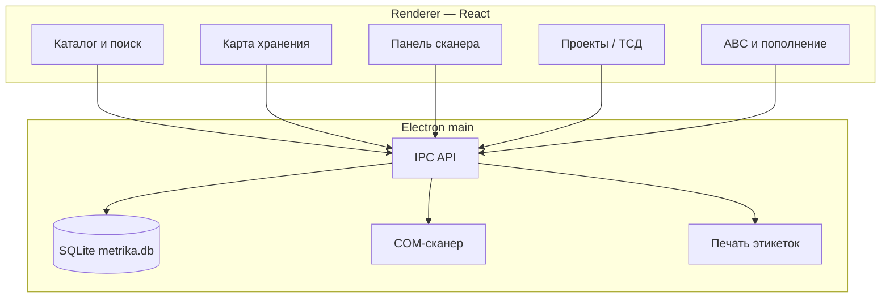
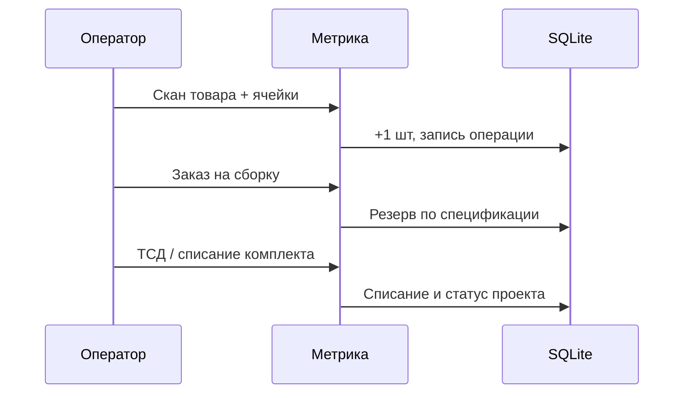

<p align="center">
  
</p>

<h1 align="center">Метрика</h1>

<p align="center">
  <strong>Локальный складской учёт для Windows</strong><br/>
  Каталог · штрихкоды · адресное хранение · сборка · аналитика<br/>
  Без облака, без аккаунта, данные остаются на вашем ПК.
</p>

<p align="center">
  <a href="LICENSE"></a>
  
  
  
  
  
</p>

---

## Зачем Метрика

Метрика — настольное приложение для учёта товаров и запасов. Оно связывает каталог, сканер штрихкодов, карту ячеек, складские операции, ревизии, сборочные проекты и аналитику в одной **локальной SQLite-базе**.

Подходит мастерской, лаборатории, малому складу или домашней «кладовой комплектующих»: быстро оприходовать сканером, найти деталь по адресу, зарезервировать комплект под заказ и понять, что пора докупить.

> **0.5 «Домашняя»** — рабочая линейка для локального контура. Сервер и «облачная учётка» для ежедневной работы не нужны.

## Возможности

| Область | Что умеет |
| --- | --- |
| **Каталог** | Несколько штрихкодов на товар, артикулы, категории, цветные метки, мин. остатки |
| **Поиск** | Префиксы `#` штрихкод, `@` название, `!` категория, `=` ячейка, `<` остаток |
| **Хранение** | Склады → подсклады → ячейки, иерархическая карта |
| **Операции** | Приёмка, расход, перемещение, пакетные действия, журнал |
| **Сканер** | COM-порт; режим «товар + ячейка (+1)» в любом порядке |
| **Ревизия** | Обход ячеек, факт vs учёт, корректировка расхождений |
| **Сборка** | Спецификация, тираж, резерв в ячейках, ТСД-сканы, списание комплекта |
| **Импорт** | CSV с предпросмотром; существующие штрихкоды не перезаписываются |
| **Печать** | Этикетки Code 128 |
| **Пополнение** | Расход 90 дней, срок поставки, страховой запас → CSV-план |
| **Аналитика** | Низкие остатки, ABC, покрытие запасом |
| **Бэкап** | Экспорт/импорт полной БД со страховкой перед заменой |

Расширенный контур 0.5 (организации, сотрудники, документы, CRM/клиентский контур, ЭДО как **внутренний** журнал — не замена оператора УКЭП) развивается поверх того же локального ядра.

## Архитектура



| Слой | Технологии |
| --- | --- |
| UI | React 18, Vite, TypeScript |
| Desktop | Electron 31 |
| Данные | better-sqlite3 (локально) |
| Устройства | serialport (сканер) |
| Печать | bwip-js (Code 128) |

База Windows: `%APPDATA%\metrika\metrika.db`

## Скрин / поток работы



## Быстрый старт

Требования: **Node.js 20+**, npm, Windows.

```powershell
git clone https://github.com/krwg/metrika.git
cd metrika
npm install
npm run rebuild
npm run dev
```

Первый запуск:

1. **Хранение** — создайте склад, подсклады и ячейки.  
2. **Категории** — цвета для карты.  
3. **Товары** — вручную или CSV.  
4. **Настройки** — COM-порт сканера.

Подробнее: [docs/GETTING_STARTED.md](docs/GETTING_STARTED.md) · [docs/USER_GUIDE.md](docs/USER_GUIDE.md)

## Сборка установщика

```powershell
npm run build
npm run dist:win
```

Или `build_installer.bat`. Артефакты — в `release/` (папка в `.gitignore`).

Portable без NSIS:

```powershell
npm run package:win
```

## Документация

| Документ | Содержание |
| --- | --- |
| [Getting started](docs/GETTING_STARTED.md) | Установка, первый склад, сканер |
| [User guide](docs/USER_GUIDE.md) | Режимы работы, CSV, поиск, резервы |
| [Architecture](docs/ARCHITECTURE.md) | Процессы Electron, IPC, БД |
| [Security](SECURITY.md) | Локальные данные и границы |
| [Contributing](CONTRIBUTING.md) | Как предлагать изменения |
| [Roadmap](docs/ROADMAP.md) | Направление 0.x |

## Принципы продукта

- **Offline-first** — ежедневная работа без сети.  
- **Один ПК — одна правда** — SQLite как источник учёта.  
- **Сканер в центре** — меньше кликов, больше штрихкодов.  
- **Честные границы** — внутренний ЭДО ≠ внешний оператор УКЭП; удалённый клиентский контур без своего сервера ограничен одной машиной.

## Лицензия

[GNU GPL v3](LICENSE) — свободное использование и модификация с сохранением тех же свобод для производных.

---

<p align="center">Сделано как локальный инструмент учёта · <a href="https://github.com/krwg">krwg</a></p>
