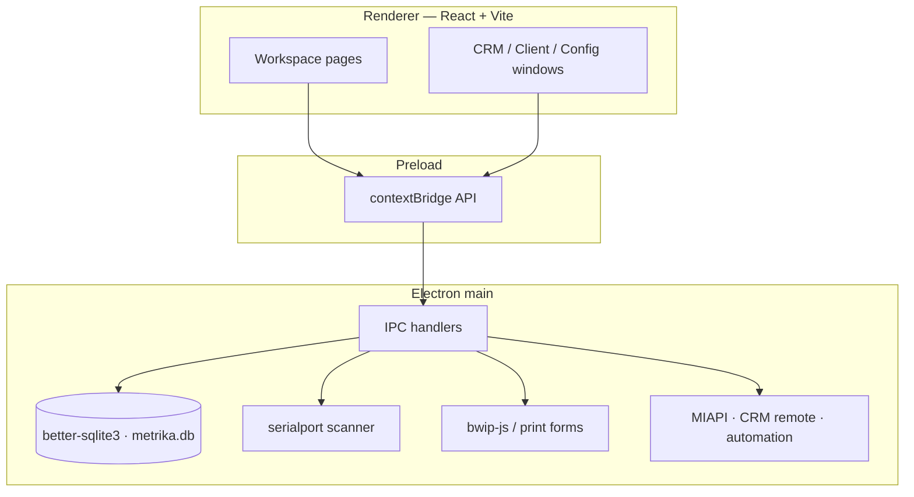
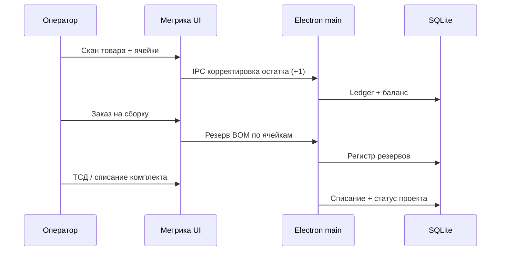

<p align="center">
  <a href="README.md">🇬🇧 English</a> · 🇷🇺 Русский
</p>

<p align="center">
  <picture>
    <source media="(prefers-color-scheme: dark)" srcset="docs/assets/readme/wordmark-dark.svg" />
    
  </picture>
</p>

<p align="center">
  <strong>Локальный складской учёт для Windows</strong><br />
  Каталог · штрихкоды · адресное хранение · сборка · аналитика<br />
  Без облачного аккаунта. Данные остаются на вашем ПК.
</p>

<p align="center">
  <a href="LICENSE"></a>
  <a href="package.json"></a>
  
  
  
  
  
  
</p>

<p align="center">
  <a href="#быстрый-старт">Быстрый старт</a> ·
  <a href="docs/USER_GUIDE.md">Руководство</a> ·
  <a href="docs/ARCHITECTURE.md">Архитектура</a> ·
  <a href="docs/ROADMAP.md">Roadmap</a> ·
  <a href="https://github.com/krwg/metrika/releases">Releases</a> ·
  <a href="https://github.com/krwg/metrika">Репозиторий</a>
</p>

<p align="center">
  
</p>

## Обзор

**Метрика** — настольная система складского учёта для мастерских, лабораторий, малых складов и домашней кладовой комплектующих. Она связывает каталог, сканер штрихкодов, карту ячеек, складские операции, ревизии, сборочные проекты, пополнение и аналитику в одной **локальной базе SQLite**.

**0.5 «Домашняя»** — линейка offline-first: для ежедневной работы не нужны сервер и облачный вход. Расширенный контур (организации, документы, CRM, внутренний ЭДО) работает на той же машине — это не hosted SaaS.

| Для кого | Чем не является |
| --- | --- |
| Один ПК как источник правды по остаткам | Обязательный облачный SaaS |
| Размещение товара сканером | Замена сертифицированного оператора ЭДО / УКЭП |
| Небольшие команды и личные склады | Мультисайтовый ERP без своего сервера |

## Возможности

### Ядро склада (реализовано)

| Область | Что умеет |
| --- | --- |
| **Каталог** | Несколько штрихкодов на товар, артикулы, вложенные категории с цветами, мин./макс. остатки, доп. поля, варианты, комплекты |
| **Поиск** | Префиксы: `#` штрихкод, `@` название, `!` категория, `=` ячейка, `<` остаток меньше N |
| **Хранение** | Склад → подсклад → карта ячеек, зоны, вместимость |
| **Операции** | Приёмка, расход, перемещение, пакетные акты, журнал ledger |
| **Сканер** | COM через `serialport`; режим «товар + ячейка (+1)» в любом порядке |
| **Ревизия** | Обход ячеек, факт vs учёт, корректировка расхождений |
| **Сборка** | Спецификация (BOM), тираж, резерв по ячейкам, комплектация ТСД, списание комплекта |
| **Закупки** | Поставщики, заказы, частичная приёмка, трекинг отправлений |
| **Импорт** | CSV с предпросмотром; существующие штрихкоды не перезаписываются |
| **Печать** | Этикетки Code 128 (`bwip-js`), печатные формы, опция ZPL |
| **Пополнение** | Расход 90 дней, срок поставки, страховой запас → CSV-план |
| **Аналитика** | Низкие остатки, ABC / XYZ, покрытие, сохранённые отчёты |
| **Бэкап** | Экспорт/импорт полной БД со страховкой перед заменой |

### Расширенный локальный контур (0.5)

В той же desktop-сборке, по-прежнему локально:

- Организации, пользователи, роли и права с привязкой к складам  
- Журнал документов (draft → posted → cancelled)  
- Окна CRM / клиентского портала (локальный транспорт; Remote HTTP — опционально и в рамках машины)  
- Внутренний журнал ЭДО и пакеты для оператора — **не** замена внешнего оператора УКЭП  
- MIAPI / webhooks / правила автоматизации для интеграций на вашем хосте  

<details>
<summary>Честные границы продукта</summary>

- Ежедневный offline-режим не требует аккаунта.  
- Открытые порты локальных API (MIAPI, CRM remote) — под вашим контролем на этом ПК.  
- Шифрование диска (BitLocker и аналоги) — зона ОС; см. [SECURITY.md](SECURITY.md).

</details>

## Превью интерфейса

Превью рабочих мест в визуальном языке приложения (иллюстративные; подписи как в русской UI по умолчанию).

<table>
  <tr>
    <td width="50%">
      
      <p align="center"><sub>Обзор — KPI и операции</sub></p>
    </td>
    <td width="50%">
      
      <p align="center"><sub>Хранение — склад → ячейки и вместимость</sub></p>
    </td>
  </tr>
  <tr>
    <td colspan="2">
      <p align="center">
        
      </p>
      <p align="center"><sub>Проекты — BOM, доступность и резервирование</sub></p>
    </td>
  </tr>
</table>

> Метрика — **desktop**-приложение. Онлайн-демо «Play» нет. Соберите из исходников или возьмите установщик Windows из [Releases](https://github.com/krwg/metrika/releases), когда он опубликован.

## Архитектура





Путь БД по умолчанию (Windows): `%APPDATA%\metrika\metrika.db`

## Технологии

| Роль | Технология | Назначение |
| --- | --- | --- |
| Оболочка | [Electron](https://www.electronjs.org/) 31 | Окна приложения, упаковка NSIS |
| UI | [React](https://react.dev/) 18 + [Vite](https://vitejs.dev/) | Рабочие места, темы, i18n RU/EN |
| Язык | [TypeScript](https://www.typescriptlang.org/) 5 | Main + renderer |
| Данные | [better-sqlite3](https://github.com/WiseLibs/better-sqlite3) | Локальный ledger и каталог |
| Устройства | [serialport](https://serialport.io/) | COM-сканеры / весы |
| Штрихкоды | [bwip-js](https://github.com/metafloor/bwip-js) | Этикетки Code 128 |
| CSV | [Papa Parse](https://www.papaparse.com/) | Импорт с предпросмотром |

## Быстрый старт

### Требования

- Windows 10 / 11  
- [Node.js](https://nodejs.org/) **20+** (LTS) и npm  
- Опционально: USB COM-сканер (HID в режиме клавиатуры тоже работает через поле ввода)

### Установка и запуск (разработка)

```powershell
git clone https://github.com/krwg/metrika.git
cd metrika
npm install
npm run rebuild
npm run dev
```

`rebuild` нужен для native-модулей (`better-sqlite3`, `serialport`) под Electron.

### Первичная настройка склада

1. **Хранение** — создайте склад, подсклады и ячейки (желательно со штрихкодами адресов).  
2. **Категории** — цвета для карты и каталога.  
3. **Товары** — вручную или импорт CSV.  
4. **Настройки** — COM-порт и скорость для serial-сканера.

Подробнее: [docs/GETTING_STARTED.md](docs/GETTING_STARTED.md) · [docs/USER_GUIDE.md](docs/USER_GUIDE.md)

### Сборка установщика Windows

```powershell
npm run build
npm run dist:win
```

Артефакты — в `release/` (в `.gitignore`). Portable без NSIS:

```powershell
npm run package:win
```

Или `build_installer.bat`.

### Самопроверки ядра (опционально)

```powershell
npm run test:all
```

Скрипты e2e CRM / MIAPI / ТСД поверх SQLite в `scripts/`.

## Структура проекта

```text
metrika/
├── src/main/           Electron main: БД, IPC, устройства, интеграции
├── src/renderer/       React UI, страницы, i18n, темы
├── scripts/            Headless e2e (*-e2e-selftest.mjs)
├── docs/               Гайды + assets для README
├── build/icon.svg      Иконка приложения
├── package.json        Scripts, Electron Builder (NSIS)
└── index.html          Точка входа Vite
```

## Roadmap

| Горизонт | Фокус |
| --- | --- |
| **Сейчас — 0.5 «Домашняя»** | Стабильный локальный склад, бэкапы, CSV, этикетки, ABC/пополнение, локальный расширенный контур |
| **Ближайшее** | Полировка установщика и обновлений, профили COM-устройств, онбординг «пустой склад → первая приёмка», сценарийные скриншоты |
| **Позже** | Опциональный серверный контур для клиентского портала с другого устройства; гибкие печатные формы; честные внешние адаптеры |
| **Не цели 0.x** | Облачный SaaS как обязательный режим; подмена оператора ЭДО; переписывание UI без продуктовой нужды |

Полные заметки: [docs/ROADMAP.md](docs/ROADMAP.md)

## Участие

1. Fork / ветка от `main`.  
2. `npm install && npm run rebuild && npm run dev`.  
3. Для затронутого контура — соответствующий `npm run test:*`.  
4. Pull Request с кратким «зачем» и способом проверки.

См. [CONTRIBUTING.md](CONTRIBUTING.md). Предпочтительны баги склада/сканера, UX онбординга, тесты и документация. Крупные архитектурные сдвиги — сначала issue.

Канонический README — **английский** (`README.md`); при смене структуры или утверждений синхронизируйте `README.ru.md`.

## Лицензия

[GNU General Public License v3.0](LICENSE) — использование, изучение, распространение и доработка с сохранением тех же свобод для производных.

Отчёты о безопасности: предпочтительно через приватный [GitHub Security Advisory](https://github.com/krwg/metrika/security/advisories) или контакт профиля [krwg](https://github.com/krwg). Подробности — в [SECURITY.md](SECURITY.md).

---

<p align="center">
  <br />
  <sub>Метрика · локальный учёт · <a href="https://github.com/krwg">krwg</a></sub>
</p>
