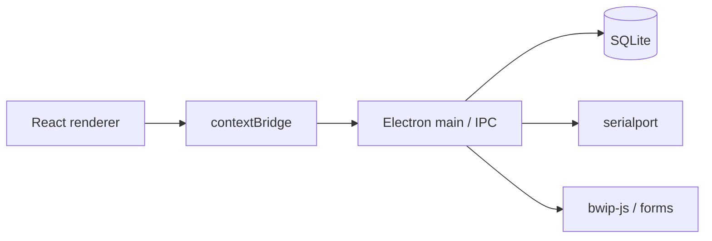

# Metrika Home 0.5 — First Public Release

**Tag:** `v0.5.0`  
**Product line:** Home [0.5]  
**Platform:** Windows 10 / 11  
**License:** [GNU GPL v3](LICENSE)

This is the **first official public release** of Metrika. It establishes the public baseline for the Home product line: a local-first warehouse inventory desktop app. There is no prior published release to upgrade from.

---

## Introduction

**Metrika** is a Windows desktop application for cataloguing goods, placing stock in addressable bins, scanning barcodes, running stocktakes, assembling kits from BOMs, planning replenishment, and reviewing analytics — all against a **local SQLite database** on your PC.

It is built for workshops, labs, small warehouses, and personal component stores that need scanner-first workflows without a cloud account. Daily work does not require a server. An optional extended local contour (organizations, documents, CRM, internal EDO, MIAPI) runs on the same machine when you need it — it is not hosted SaaS.

Home [0.5] is the public name for version **0.5.0** in `package.json` / the Windows installer.

## What's included

| Area | In this release |
| --- | --- |
| Catalog | Items, multi-barcodes, SKUs, nested categories, custom fields, variants, kits |
| Storage | Warehouse → sub-location → bins, zones, capacity cues |
| Stock ops | Receive, issue, transfer, ledger history, batch acts |
| Scanner | COM (`serialport`); item + bin (+1) in any order |
| Stocktake | Bin walk, fact vs book, variance correction |
| Assembly | BOM, run size, cell reserves, TSD picks, kit consume |
| Purchasing | Suppliers, POs, partial receipts, shipment tracking |
| Import / print | CSV with preview; Code 128 labels; printable forms; ZPL option |
| Analytics | Low stock, ABC / XYZ, coverage, replenishment CSV plan |
| Backup | Full DB export/import with safety copy before replace |
| Extended local | Orgs/users/ACL, document journal, CRM/client windows, internal EDO, MIAPI / webhooks / automation |

## Key features

- **Offline-first** — no account for everyday inventory work  
- **Scanner-centred placement** — fewer clicks, more barcodes  
- **Address storage map** — find parts by bin, not by memory  
- **Assembly with reserves** — BOM → reserve → pick → consume  
- **Honest boundaries** — internal EDO ≠ certified УКЭП operator; remote client access needs an explicit local/remote contour you control  

<p align="center">
  
</p>

<p align="center">
  
</p>

<p align="center">
  
</p>

## Technical overview

| Layer | Stack |
| --- | --- |
| Desktop | Electron 31 |
| UI | React 18, Vite, TypeScript, RU/EN i18n |
| Data | better-sqlite3 → `%APPDATA%\metrika\metrika.db` |
| Devices | serialport (COM scanners / scales) |
| Labels | bwip-js (Code 128) |
| Packaging | electron-builder NSIS → `Metrika0.5-Setup-0.5.0.exe` |



## Getting started

### Option A — Windows installer (recommended)

1. Download **`Metrika0.5-Setup-0.5.0.exe`** from this release (~80 MB).  
2. Optional integrity check — SHA-256:

   `eaba475d4278055f0bd4dedc8b70ccbe0af8de5a2878a5beaaac52391e4ee6e2`

3. Run the installer (choose install directory if needed).  
4. Launch **Метрика0.5** from the Start menu or desktop shortcut.  
5. Create a warehouse → bins → items (or CSV import) → optional COM scanner in Settings.

### Option B — From source

Requires Node.js **20+** and Windows 10/11.

```powershell
git clone https://github.com/krwg/metrika.git
cd metrika
git checkout v0.5.0
npm install
npm run rebuild
npm run dev
```

Build the installer yourself:

```powershell
npm run dist:win
```

Artifacts appear under `release/` (gitignored).

Docs: [Getting started](docs/GETTING_STARTED.md) · [User guide](docs/USER_GUIDE.md) · [Architecture](docs/ARCHITECTURE.md)

## Current limitations

- **Windows only** in this release (no macOS / Linux packages).  
- **No hosted online demo** — desktop binary or source only.  
- **0.x maturity** — feature-rich Home line, not a 1.0 LTS claim.  
- Optional local APIs (MIAPI, CRM remote) expose ports **only when enabled**; you own that surface.  
- Internal EDO / operator packages are **not** a substitute for a certified EDO / УКЭП operator.  
- Disk encryption remains an OS concern (BitLocker, etc.).  
- Installer is unsigned unless you sign it yourself — SmartScreen may warn on first run.

## What's next

| Priority | Direction |
| --- | --- |
| Near term | Installer/update polish, COM device profiles, faster empty-warehouse onboarding, real scenario screenshots |
| Later | Optional server contour for client portal off-box; richer print forms; honest external adapters |
| Not goals for 0.x | Cloud SaaS as required mode; pretending to be a certified EDO operator |

See [docs/ROADMAP.md](docs/ROADMAP.md).

## Acknowledgements

Maintained by [krwg](https://github.com/krwg). Thanks to everyone testing the Home line locally before this public cut.

## License

Distributed under the [GNU General Public License v3.0](LICENSE). You may use, study, share, and modify the software provided derivative works remain under GPL-3.0.

Security reports: private [Security Advisory](https://github.com/krwg/metrika/security/advisories) or contact via [krwg](https://github.com/krwg) — see [SECURITY.md](SECURITY.md).
