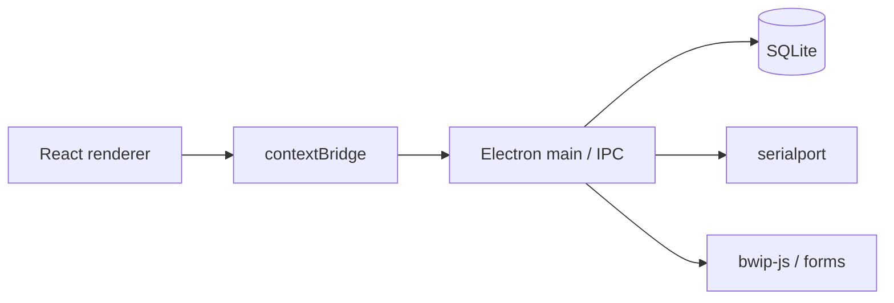

# Метрика Home 0.5 — первый публичный релиз

**Тег:** `v0.5.0`  
**Линейка:** Home [0.5] / «Домашняя»  
**Платформа:** Windows 10 / 11  
**Лицензия:** [GNU GPL v3](LICENSE)

Это **первый официальный публичный релиз** Метрики. Он фиксирует публичную базовую линию продукта Home: локальный desktop-учёт склада. Предыдущего опубликованного релиза для обновления нет.

---

## Введение

**Метрика** — Windows-приложение для каталога товаров, адресного хранения, сканирования штрихкодов, ревизий, сборки по спецификации (BOM), плана пополнения и аналитики — всё на **локальной базе SQLite** на вашем ПК.

Оно рассчитано на мастерские, лаборатории, малые склады и домашние кладовые комплектующих, где нужен сценарий «сканер в центре», без облачного аккаунта. Для ежедневной работы сервер не обязателен. Расширенный локальный контур (организации, документы, CRM, внутренний ЭДО, MIAPI) доступен на той же машине — это не hosted SaaS.

Home [0.5] — публичное имя версии **0.5.0** из `package.json` / установщика Windows.

## Что входит в релиз

| Область | В этом релизе |
| --- | --- |
| Каталог | Товары, несколько штрихкодов, артикулы, вложенные категории, доп. поля, варианты, комплекты |
| Хранение | Склад → подсклад → ячейки, зоны, вместимость |
| Операции | Приёмка, расход, перемещение, журнал ledger, пакетные акты |
| Сканер | COM (`serialport`); товар + ячейка (+1) в любом порядке |
| Ревизия | Обход ячеек, факт vs учёт, корректировка расхождений |
| Сборка | BOM, тираж, резерв по ячейкам, комплектация ТСД, списание комплекта |
| Закупки | Поставщики, заказы, частичная приёмка, трекинг отправлений |
| Импорт / печать | CSV с предпросмотром; этикетки Code 128; печатные формы; опция ZPL |
| Аналитика | Низкие остатки, ABC / XYZ, покрытие, CSV-план пополнения |
| Бэкап | Полный экспорт/импорт БД со страховкой перед заменой |
| Расширенный локальный контур | Организации/пользователи/ACL, журнал документов, CRM/клиент, внутренний ЭДО, MIAPI / webhooks / автоматизация |

## Ключевые возможности

- **Offline-first** — ежедневный учёт без аккаунта  
- **Сканер в центре** — меньше кликов, больше штрихкодов  
- **Адресная карта** — искать деталь по ячейке, а не по памяти  
- **Сборка с резервами** — BOM → резерв → комплектация → списание  
- **Честные границы** — внутренний ЭДО ≠ сертифицированный оператор УКЭП; удалённый клиентский доступ — только при явно включённом контуре под вашим контролем  

<p align="center">
  
</p>

<p align="center">
  
</p>

<p align="center">
  
</p>

## Технический обзор

| Слой | Стек |
| --- | --- |
| Desktop | Electron 31 |
| UI | React 18, Vite, TypeScript, i18n RU/EN |
| Данные | better-sqlite3 → `%APPDATA%\metrika\metrika.db` |
| Устройства | serialport (COM-сканеры / весы) |
| Этикетки | bwip-js (Code 128) |
| Упаковка | electron-builder NSIS → `Metrika0.5-Setup-0.5.0.exe` |



## Быстрый старт

### Вариант A — установщик Windows (рекомендуется)

1. Скачайте **`Metrika0.5-Setup-0.5.0.exe`** из этого релиза (~80 МБ).  
2. При желании проверьте SHA-256:

   `eaba475d4278055f0bd4dedc8b70ccbe0af8de5a2878a5beaaac52391e4ee6e2`

3. Запустите установщик (при необходимости выберите каталог).  
4. Откройте **Метрика0.5** из меню «Пуск» или с ярлыка.  
5. Создайте склад → ячейки → товары (или CSV) → при необходимости COM-сканер в Настройках.

### Вариант B — из исходников

Нужны Node.js **20+** и Windows 10/11.

```powershell
git clone https://github.com/krwg/metrika.git
cd metrika
git checkout v0.5.0
npm install
npm run rebuild
npm run dev
```

Собрать установщик самостоятельно:

```powershell
npm run dist:win
```

Артефакты — в `release/` (в `.gitignore`).

Документация: [Getting started](docs/GETTING_STARTED.md) · [User guide](docs/USER_GUIDE.md) · [Architecture](docs/ARCHITECTURE.md)

## Текущие ограничения

- Только **Windows** в этом релизе (нет пакетов macOS / Linux).  
- **Нет онлайн-демо** — только установщик или исходники.  
- Зрелость **0.x** — богатая линейка Home, без заявления о 1.0 LTS.  
- Опциональные локальные API (MIAPI, CRM remote) открывают порты **только если включены**.  
- Внутренний ЭДО / пакеты оператору **не** заменяют сертифицированного оператора ЭДО / УКЭП.  
- Шифрование диска — зона ОС (BitLocker и аналоги).  
- Установщик по умолчанию **не подписан** — SmartScreen может предупредить при первом запуске.

## Что дальше

| Приоритет | Направление |
| --- | --- |
| Ближайшее | Полировка установщика и обновлений, профили COM, быстрый онбординг пустого склада, сценарийные скриншоты |
| Позже | Опциональный серверный контур клиентского портала; гибкие печатные формы; честные внешние адаптеры |
| Не цели 0.x | Облачный SaaS как обязательный режим; подмена сертифицированного оператора ЭДО |

См. [docs/ROADMAP.md](docs/ROADMAP.md).

## Благодарности

Поддержка: [krwg](https://github.com/krwg). Спасибо всем, кто проверял линейку Home локально до этой публичной сборки.

## Лицензия

Распространяется на условиях [GNU General Public License v3.0](LICENSE). Можно использовать, изучать, распространять и изменять при сохранении GPL-3.0 для производных.

Уязвимости: приватный [Security Advisory](https://github.com/krwg/metrika/security/advisories) или контакт [krwg](https://github.com/krwg) — см. [SECURITY.md](SECURITY.md).
