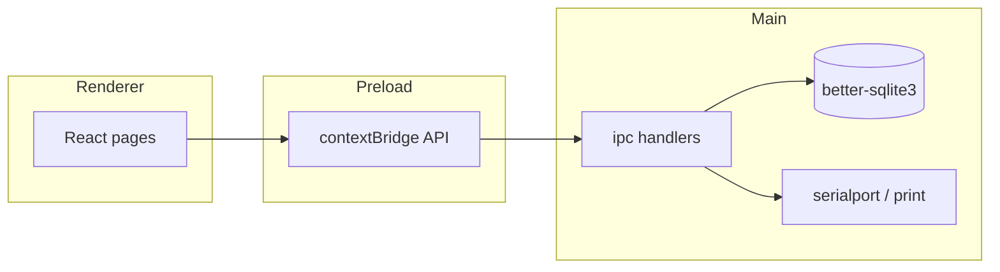

# Architecture — Метрика

## Обзор

Метрика — **Electron**-приложение с разделением на:

- **main** — Node/Electron: SQLite, IPC, COM-сканер, печать, фоновые задачи;
- **renderer** — React UI (Vite);
- **preload** — узкий мост API без прямого доступа к Node из страницы.

Данные по умолчанию живут в одном файле SQLite на машине пользователя.



## Каталоги исходников

```
src/
  main/          Electron main, БД, IPC, устройства
  renderer/      React UI, страницы, i18n
  shared/        Общие типы (если используются)
```

Ключевые точки входа:

| Файл | Роль |
| --- | --- |
| `src/main/main.ts` | Старт приложения, окна |
| `src/main/preload.ts` | API для renderer |
| `src/main/ipc.ts` / `ipcModern.ts` | Обработчики IPC |
| `src/main/db.ts` | Схема и доступ к SQLite |
| `src/main/scanner.ts` | COM-сканер |
| `src/renderer/App.tsx` | Навигация и рабочие места |
| `src/renderer/main.tsx` | Монтирование React |

## Данные

- Файл БД (Windows): `%APPDATA%\metrika\metrika.db`
- Миграции выполняются при старте main-процесса
- Экспорт/импорт — полный снимок учёта; перед импортом пишется страховка в `backups`

Организационный контур (если включён) может использовать registry + org DB — см. код `registry.ts`, `companyHub.ts`. Для сценария «домашний склад» достаточно одной пользовательской БД.

## IPC и безопасность UI

- Renderer не получает произвольный Node/`fs`.
- Операции идут через явные методы preload.
- Чувствительные действия (сырой SQL, админ-операции) ограничиваются сессией/ролью в main (см. `permissions.ts`).

## Устройства и печать

- **serialport** — сканеры в режиме COM.
- **bwip-js** — генерация Code 128 для этикеток.
- Печатные формы/шаблоны — модули `printForms.ts`, `printTemplates.ts`.

## Тесты

Самопроверки без GUI:

```powershell
npm run test:crm
npm run test:miapi
npm run test:tsd
npm run test:all
```

Они поднимают временные SQLite и прогоняют сквозные сценарии из `scripts/`.

## Сборка

```powershell
npm run build       # tsc main + vite renderer → dist/
npm run dist:win    # electron-builder → release/ (gitignore)
```

`package.json → build` задаёт `appId`, NSIS и состав `files` для упаковки.
